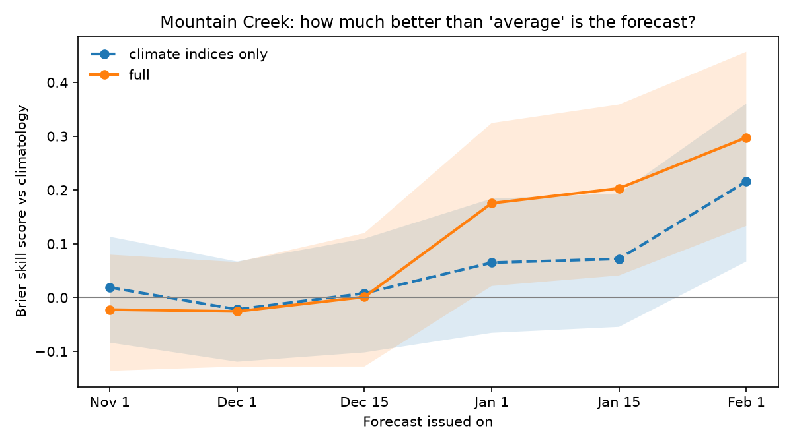

# 🏂 Mountain Creek Season Forecaster

**Will this winter be a good one at Mountain Creek (Vernon, NJ)?** This project gives a probabilistic answer
built from 76 winters (1950–2025) of NOAA weather-station records and large-scale climate patterns. It forecasts
before the season starts and updates as the winter goes on.

> Status: trained and evaluated on real NOAA data; live forecasts for the 2026–27 season are logged in
> `reports/forecast_log.csv` and will be scored in April 2027.

## The question

A season is "good" if it finishes **above the historical median** for the chosen target (set in `src/config.py`):

| Target | What it measures |
|---|---|
| `snowfall_in` (default) | Total natural snowfall, Nov 1 – Apr 30 |
| `depth_days` | Days with ≥1" of snow on the ground |
| `snowmaking_nights` | Nights ≤25°F. For an East Coast resort, cold for snowmaking matters as much as natural snow |

Forecasts are issued at six **checkpoints** (Nov 1, Dec 1, Dec 15, Jan 1, Jan 15, Feb 1), and each one uses
only information that was actually available on that date.

## Data (all free, public)

- **NOAA GHCN-Daily**: daily snowfall, snow depth and temperature. `fetch_data.py` automatically finds the
  nearest stations to the resort with ≥25 years of snowfall records.
- **ENSO / ONI** (El Niño–La Niña), **NAO** (North Atlantic Oscillation) and **AO** (Arctic Oscillation)
  from NOAA's Climate Prediction Center.

## Method

1. **Training window.** The station records go back to 1893 (129 complete seasons), but the ONI, NAO and AO
   records start in 1950. Models are trained and evaluated only on seasons from 1950 on (`FIRST_TRAIN_SEASON`
   in `src/config.py`), so every season has real climate-index values instead of imputed ones.
2. **Station blending.** The station with the most complete record is primary. Seasons it missed are filled from
   the nearest neighbour, rescaled by the median ratio between the two stations (they sit at different elevations).
3. **Features at each checkpoint.** Each one uses only data from before the checkpoint date:

   | Feature | Definition | Why it matters |
   |---|---|---|
   | Snow to date | Total snowfall since Oct 1 (in) | Snowy starts tend to become snowy seasons |
   | Snow-on-ground days | Days since Oct 1 with ≥1" snow depth | Snow that sticks around signals a lasting cold pattern |
   | Snowmaking nights | Nights since Oct 1 with a low ≤25°F | Mountain Creek depends on making snow |
   | Temperature anomaly | Mean daily temperature vs. that station's normal for the date (°F) | Colder than normal so far |
   | ONI | Latest El Niño / La Niña index | Pacific pattern that shifts winter storm tracks |
   | NAO, AO | Mean of the last 2 months | Negative phases favour cold, stormy Northeast winters |

   A station series with more than 15% missing days is left blank (filled with the training median) rather
   than counted as zero. Features that are nearly constant at a checkpoint (e.g. snow depth on Nov 1) are dropped.
4. **Models:** regularized logistic regression (probability of an above-median season) and ridge regression
   (expected total). There are two variants: *climate indices only* and *full* (indices plus season-to-date
   observations).
5. **Evaluation:** leave-one-season-out cross-validation. The median threshold is recomputed inside each
   fold to avoid leakage. Skill is reported as the **Brier Skill Score vs. climatology** (always guessing the
   base rate), with 90% bootstrap confidence intervals.

## Results

Leave-one-season-out cross-validation over 76 seasons (1950–2025), target = total snowfall above the median.
Baseline ("climatology") always predicts the base rate and the historical average.



| Checkpoint | Brier skill score, full model (90% CI) | Above/below median correct | Mean abs. error, model vs. baseline |
|---|---|---|---|
| Nov 1 | -0.02 (-0.14 to 0.08) | 59% | 14.8 vs 14.9 in |
| Dec 1 | -0.03 (-0.13 to 0.07) | 54% | 15.5 vs 14.9 in |
| Dec 15 | 0.00 (-0.13 to 0.12) | 58% | 14.6 vs 14.9 in |
| **Jan 1** | **0.18 (0.02 to 0.33)** | **72%** | **11.8 vs 14.9 in** |
| **Jan 15** | **0.20 (0.04 to 0.36)** | **74%** | **12.1 vs 14.9 in** |
| **Feb 1** | **0.30 (0.13 to 0.46)** | **72%** | **10.4 vs 14.9 in** |

- **No skill before January.** Through Dec 15, neither model beats climatology. The climate indices alone carry
  too little signal for Northeast snowfall this early, which is consistent with the limitations below.
- **Real skill from Jan 1 on.** Once a month or two of the season has been observed, the full model's 90% interval
  stays above zero. By Feb 1 it cuts the snowfall error by 30% (10.4 vs 14.9 in).
- **Season-to-date observations matter more than the indices.** The full model beats the climate-indices-only
  model at every checkpoint from Jan 1 on (Jan 1: 0.18 vs 0.07).

## Run it

```bash
python3 -m venv .venv && source .venv/bin/activate
pip install -r requirements.txt

python -m src.fetch_data      # download NOAA data (a few minutes the first time)
python -m src.build_dataset   # clean + build season targets and checkpoint features
python -m src.train           # cross-validate, save models + reports
python -m src.predict         # forecast the season in progress
streamlit run app.py          # dashboard

python -m pytest -q           # end-to-end tests on synthetic data (no internet needed)
```

During the season, re-run `fetch_data → build_dataset → predict` to update the forecast with new observations.

Each checkpoint's forecast is appended to `reports/forecast_log.csv` the first time it is issued and never
rewritten, together with the model version that produced it. That file is the live record used to score the
season in April. Once a forecast is logged for the current season, `python -m src.train` refuses to replace the
model (use `--force` only between seasons), so every live forecast in a season comes from the same frozen model.

## Project structure

```
src/config.py         resort location, season definition, target, data URLs
src/fetch_data.py     station discovery + downloads
src/build_dataset.py  unit conversion, QC, station blending, targets, features
src/train.py          cross-validation, skill scores, final models
src/predict.py        current-season forecast
app.py                Streamlit dashboard
tests/                synthetic NOAA-format data + end-to-end tests
```

## Limitations

- Only 76 seasons have climate-index data, so any skill estimate has wide error bars. That's why the
  confidence intervals are reported.
- Natural snowfall at a valley station is not the same as conditions on the slopes, and Mountain Creek relies
  heavily on snowmaking.
- Climate indices have only a modest, region-dependent effect on Northeast winters.
- The models are linear, so they can't capture combined effects (e.g. El Niño *and* a negative NAO). That's a
  deliberate trade-off: with 76 seasons, a more flexible model would overfit.
- The backtest treats each monthly climate index as available on the 1st of the following month. In practice
  NOAA publishes it a few days later, so the cross-validated skill at early checkpoints may be slightly optimistic.
